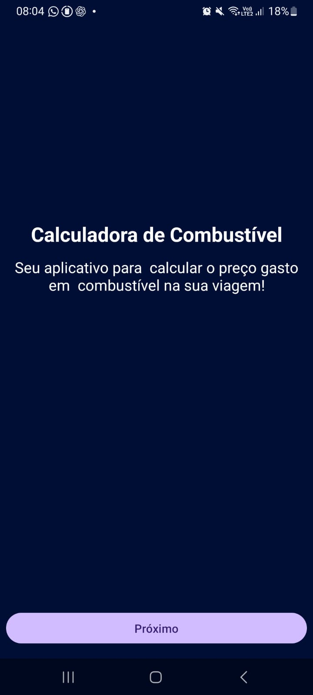
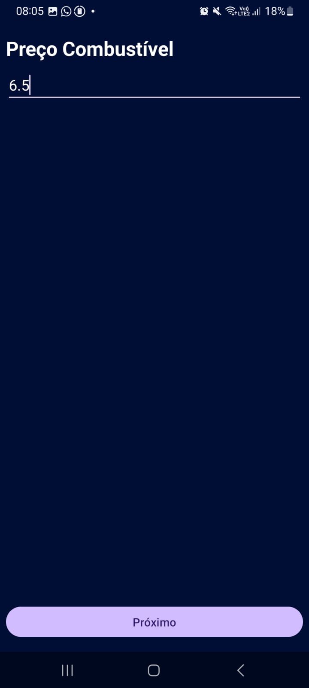
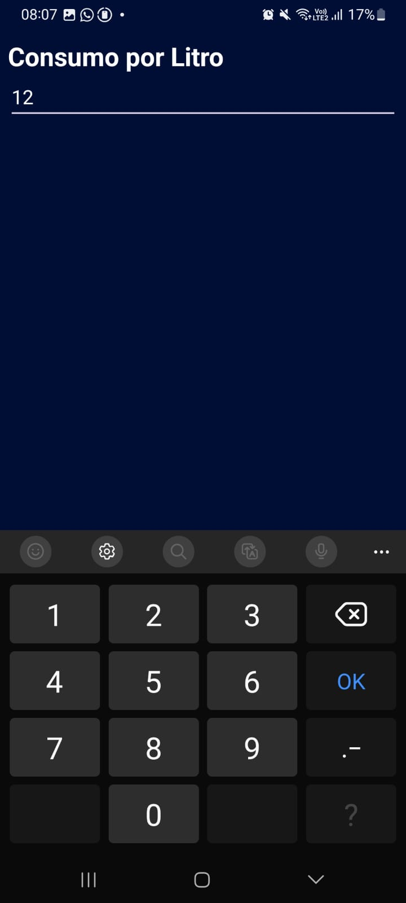
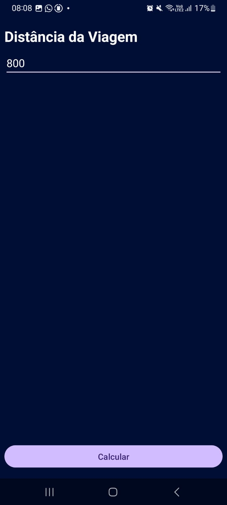
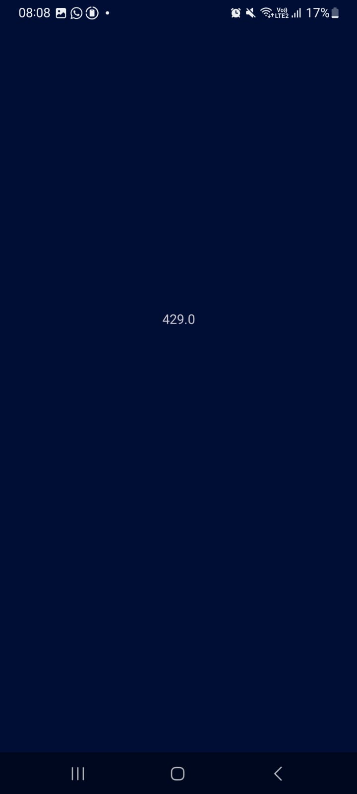

# ⛽ FuelCalculator (Calculadora de Combustível)

> Projeto desenvolvido como o meu primeiro aplicativo Android nativo durante o **Desafio de 10 dias da Escola Nova Era**, utilizando **Kotlin** e **Android Studio**.

---

## 📌 Sobre o Projeto

O **FuelCalculator** é um aplicativo mobile simples e intuitivo desenvolvido para auxiliar motoristas a calcularem o custo estimado de combustível para uma viagem ou trajeto.

A proposta central do desafio foi desmistificar o desenvolvimento Android para iniciantes, praticando:
- Criação e estilização de interfaces em XML (`ConstraintLayout`, `LinearLayout`);
- Navegação entre múltiplas telas via **Intents explícitas**;
- Passagem e recuperação de dados entre telas (`Intent Extras`);
- Lógica básica de cálculo em **Kotlin**;
- Execução e depuração direta em dispositivo físico.

---

## 📱 Fluxo do Aplicativo & Telas

O aplicativo divide a experiência em etapas simples para o usuário:

1. **Tela Inicial (`MainActivity`)**: Apresentação do app com botão para iniciar o cálculo.
2. **Preço do Combustível (`PrecoCombustivelActivity`)**: O usuário informa o valor atual do litro do combustível (ex: R$ 5,80).
3. **Consumo Médio (`ConsumoPorLitroActivity`)**: O usuário digita a média de autonomia do veículo em km/litro (ex: 12 km/l).
4. **Distância (`DistanciaActivity`)**: O usuário insere a distância total planejada para o trajeto em km (ex: 150 km) e aciona o cálculo.
5. **Resultado (`ResultadoActivity`)**: Exibe o valor total estimado a ser gasto no trajeto com base na fórmula:
   $$\text{Litros Necessários} = \frac{\text{Distância}}{\text{Consumo}}$$
   $$\text{Custo Total} = \text{Litros Necessários} \times \text{Preço do Litro}$$

---

## 📸 Demonstração / Screenshots

### Fluxo Sequencial de Uso

Abaixo está a sequência completa de interação do usuário tela a tela:

| 1. Início | ➔ | 2. Preço do Litro | ➔ | 3. Consumo (km/l) | ➔ | 4. Distância | ➔ | 5. Resultado |
| :---: | :---: | :---: | :---: | :---: | :---: | :---: | :---: | :---: |
|  | |  | |  | |  | |  |
| *Boas-vindas e início* | | *Valor por litro* | | *Autonomia (km/l)* | | *Km a percorrer* | | *Custo final calculado* |

---

## 💻 Emulador vs. Celular Físico no Windows

Durante o desenvolvimento deste projeto em um computador com sistema operacional **Windows**, a opção escolhida foi **testar e executar o aplicativo diretamente em um celular físico** (via cabo USB).

### Por que evitar o emulador em máquinas com recursos limitados?
- **Alto consumo de memória RAM**: Um emulador Android padrão (AVD) costuma alocar sozinho entre **3 GB a 5 GB de RAM**, além de consumir recursos pesados do Windows e do Android Studio. Em máquinas com 8 GB ou até 16 GB, isso frequentemente causa travamentos, lentidão severa e congelamento do sistema.
- **Sobrecarga de CPU e Virtualização**: O emulador exige recursos de virtualização de hardware (Hyper-V, HAXM, VT-x/AMD-V) ativos na BIOS/Windows, gerando aquecimento e alto uso do processador.
- **Espaço em disco**: Cada imagem de emulador criada pode ocupar de 6 GB a 15 GB adicionais no SSD/HD.

### Vantagens de testar no celular físico:
- **Zero consumo de RAM extra no computador**;
- **Desempenho 100% fluido e real** (testa a velocidade real de toque, layout e resposta do aparelho);
- **Builds e inicializações muito mais rápidas** durante o ciclo de desenvolvimento.

---

## 🛠️ Tecnologias e Ferramentas

- **Linguagem**: [Kotlin](https://kotlinlang.org/)
- **Plataforma**: Android SDK (Min SDK: 24 / Target SDK: 37)
- **IDE**: [Android Studio](https://developer.android.com/studio)
- **Gerenciador de Dependências e Build**: Gradle com Kotlin DSL (`build.gradle.kts`)
- **Layouts**: Android XML com `ConstraintLayout` e `LinearLayout`
- **Navegação**: Intents explícitas com transporte de dados (`Bundle` / `Intent Extras`)

---

## 🚀 Como Clonar e Executar o Projeto

### Pré-requisitos
Antes de começar, certifique-se de ter instalado em seu computador:
1. **Git** ([Download do Git](https://git-scm.com/));
2. **Android Studio** instalado e atualizado ([Download do Android Studio](https://developer.android.com/studio));
3. **Cabo USB** para conectar o smartphone ao PC (ou conexão Wi-Fi na mesma rede local);
4. Um celular com **Android 7.0 (Nougat)** ou superior.

---

### Passo 1: Clonar o repositório
Abra o terminal (PowerShell, CMD ou Git Bash) e execute:
```bash
git clone https://github.com/Grid2109/app-fuelCalculator-10-challenge.git
```

Acesse a pasta do projeto:
```bash
cd app-fuelCalculator-10-challenge
```

---

### Passo 2: Abrir no Android Studio
1. Abra o **Android Studio**.
2. Na tela de boas-vindas, clique em **Open** (ou no menu superior: `File` > `Open...`).
3. Navegue até a pasta onde clonou o projeto (`fuelCalculator`) e selecione-a.
4. Aguarde a sincronização inicial do **Gradle** (*Gradle Sync*). Isso pode levar alguns minutos na primeira execução, pois o Gradle fará o download das bibliotecas e dependências necessárias.

---

## 📲 Como Testar o App Diretamente no Celular

### Método Principal: Conexão via Cabo USB (Recomendado)

#### 1. Ativar as Opções do Desenvolvedor no Celular
No seu aparelho Android:
1. Abra as **Configurações** do celular.
2. Role até o final e toque em **Sobre o telefone** (ou *Sobre o dispositivo*).
3. Localize o campo **Número da versão** (ou *Número de compilação* / *Build number*).
4. Toque repetidamente **7 vezes** sobre ele até aparecer a mensagem: *"Você agora é um desenvolvedor!"*.

#### 2. Ativar a Depuração USB
1. Volte à tela principal de **Configurações**.
2. Acesse **Sistema** > **Opções do desenvolvedor** (em algumas marcas fica em *Configurações adicionais*).
3. Encontre e ative a chave **Depuração USB** (*USB Debugging*). Confirme a mensagem de alerta.

#### 3. Conectar o Celular ao Computador Windows
1. Conecte o celular ao computador usando um cabo USB de boa qualidade (que permita transferência de dados, não apenas carregamento).
2. Na tela do celular, selecione o modo de conexão USB como **Transferência de arquivos (MTP)** se solicitado.
3. Surgirá na tela do celular um pop-up de segurança: **"Permitir depuração USB?"**.
4. Marque a caixa de seleção *"Sempre permitir a partir deste computador"* e toque em **Permitir**.

> 💡 **Dica para Windows:** Se o Android Studio não reconhecer o seu aparelho de imediato, pode ser necessário instalar o driver USB OEM da fabricante do seu celular (Samsung, Motorola, Xiaomi, etc.) ou via Android Studio em `Tools` > `SDK Manager` > `SDK Tools` > marque **Google USB Driver** e clique em **Apply**.

#### 4. Executar o App
1. No topo do Android Studio, localize a barra de ferramentas.
2. Na lista suspensa de dispositivos (ao lado do botão verde de Play ▶), selecione o modelo do seu celular físico.
3. Clique no botão **Run 'app'** (ícone verde de Play ▶) ou use o atalho **`Shift + F10`**.
4. O app será compilado, instalado e aberto automaticamente na tela do seu smartphone!

---

### Método Alternativo: Conexão via Wi-Fi (Android 11+)

Se você preferir testar sem cabos e seu celular possuir Android 11 ou superior:
1. Certifique-se de que o computador e o celular estão conectados na **mesma rede Wi-Fi**.
2. No celular, em **Opções do desenvolvedor**, ative a opção **Depuração sem fio** (*Wireless debugging*).
3. No Android Studio, clique no seletor de dispositivos e escolha **Pair Devices Using Wi-Fi**.
4. Toque em *Parear com código QR* no celular e aponte a câmera para o QR Code exibido no Android Studio.
5. Pronto! O dispositivo aparecerá disponível para execução imediata.

---

### 🔄 Como ir testando as alterações em tempo real
Conforme você faz alterações no código Kotlin ou nos layouts XML:
- **Apply Changes and Restart Activity** (`Ctrl + Alt + F10` no Windows): aplica pequenas alterações visuais e de código instantaneamente sem precisar reinstalar o app todo.
- **Run 'app'** (`Shift + F10`): recompila e reinstala a versão atualizada no aparelho.

---

## 📊 Status do Projeto & Próximos Passos

O projeto cumpre o objetivo pedagógico proposto pelo desafio: estruturar a base funcional de navegação e cálculo de combustível em Kotlin.

### O que já está funcional:
- [x] Telas sequenciais de entrada de dados (Preço, Consumo, Distância);
- [x] Navegação fluida entre telas através de Intents explícitas;
- [x] Lógica de cálculo do custo total da viagem;
- [x] Execução e testes validados em dispositivo físico Android.

### Próximos passos e melhorias planejadas:
- [ ] Conclusão e refinamento visual da tela de **Resultado (`ResultadoActivity`)** (organização dos dados da viagem em cards);
- [ ] Validação de entradas (evitar crashes caso o usuário toque em "Próximo" com campos vazios);
- [ ] Ajuste no cálculo para permitir divisão com casas decimais (uso de `Double` na distância e consumo);
- [ ] Formatação monetária dos resultados no padrão brasileiro (`R$ 0,00`);
- [ ] Botão de "Recalcular" / "Início" na tela final para reiniciar o fluxo.

---

## 👩‍💻 Autoria

Desenvolvido por **Ingrid** durante o desafio de 10 dias de desenvolvimento mobile Android promovido pela **Escola Nova Era**.
